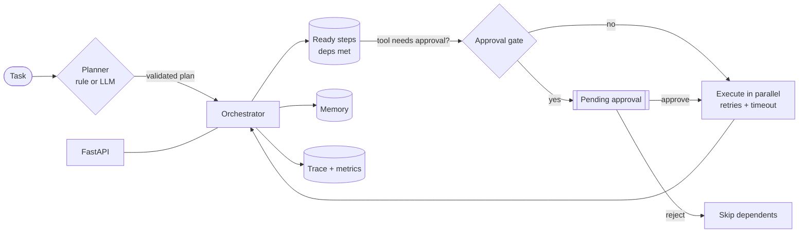
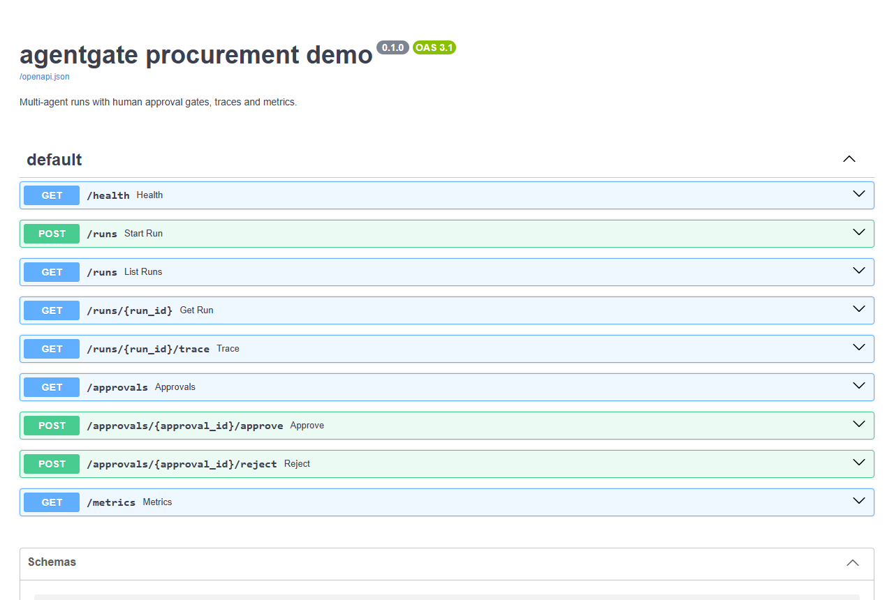

# agentgate

**Multi-agent orchestration for Python with human approval gates built in.**
Plan a task, route each step to the agent allowed to do it, run independent steps in parallel, and pause any risky
tool call until a person approves it — with retries, timeouts, memory, traces and metrics, served over FastAPI.

[](https://github.com/SB110604/agentgate/actions/workflows/ci.yml)
[](LICENSE)


> Agents that can *act* — refund money, place orders, send e-mails — need a brake. In agentgate the approval rule
> lives on the tool itself (`requires_approval=lambda args: args["amount"] > 1000`), so no plan, prompt or LLM
> mistake can skip it.

## Features

| | |
|---|---|
| **Planning** | `RulePlanner` (deterministic regex playbooks, no LLM needed) or `LLMPlanner` (JSON plan from any OpenAI-compatible model, validated and retried once with the error) |
| **Multi-agent** | Each agent owns a set of tools; a plan that gives a tool to the wrong agent is rejected before anything runs |
| **Tool calling** | `@tool` turns a type-hinted function into a tool with a pydantic-validated JSON schema |
| **Data flow** | Later steps use earlier outputs with `${step}` or `${step.field.0}` |
| **Parallelism** | Steps whose dependencies are met run concurrently (thread pool) |
| **Human approval** | Per-tool rule on the validated arguments; the run pauses, then resumes on approve or skips dependents on reject (reason required) |
| **Error handling** | Retries with exponential backoff, per-tool timeouts, failed or rejected steps skip their dependents |
| **Memory** | Short-term conversation window for the LLM planner; long-term SQLite memory with keyword-ranked recall; successful runs are remembered |
| **Monitoring** | Per-run event trace and metrics: counters plus per-tool latency (avg, p95, max) |
| **API** | FastAPI app: runs, approvals, traces, metrics, optional API key |

Only two runtime dependencies (`pydantic`, `httpx`); FastAPI is optional.

## Architecture



## Quick start

```bash
git clone https://github.com/SB110604/agentgate.git
cd agentgate
python -m venv .venv && source .venv/bin/activate     # Windows: .venv\Scripts\activate
pip install -e ".[dev]"
python examples/quickstart.py
```

```python
from agentgate import Agent, Orchestrator, Playbook, RulePlanner, StepSpec, tool

@tool(description="Look up a customer's outstanding balance")
def get_balance(customer: str) -> float:
    return {"acme": 12_500.0, "globex": 800.0}[customer]

@tool(description="Issue a refund", requires_approval=lambda a: a["amount"] > 1_000)
def refund(customer: str, amount: float) -> str:
    return f"refunded {amount:.2f} to {customer}"

planner = RulePlanner([Playbook("refund", r"refund (\w+)", lambda m: [
    StepSpec("bal", "support", "get_balance", {"customer": m[1]}),
    StepSpec("pay", "finance", "refund", {"customer": m[1], "amount": "${bal}"}, ["bal"]),
])])
orch = Orchestrator([Agent("support", "support agent", [get_balance]),
                     Agent("finance", "finance agent", [refund])], planner)

run = orch.run("refund acme")                  # status: waiting_approval
approval = orch.pending_approvals()[0]
run = orch.decide(approval.id, approve=True, by="finance-lead")
```

Real output of `examples/quickstart.py`:

```text
globex: succeeded -> refunded 800.00 to globex
acme:   waiting_approval
        approval needed: refund {'customer': 'acme', 'amount': 12500.0}
acme:   succeeded -> refunded 12500.00 to acme
metrics: {'runs_started': 2, 'steps_succeeded': 4, 'runs_succeeded': 2, 'approvals_requested': 1, 'approvals_approved': 1}
```

### Use an LLM planner

```python
from agentgate import LLMPlanner, OpenAICompatibleLLM, ConversationMemory

llm = OpenAICompatibleLLM(base_url="http://localhost:11434/v1", model="llama3.1")   # Ollama, OpenAI, vLLM, ...
orch = Orchestrator(agents, LLMPlanner(llm, memory=ConversationMemory()))
```

The LLM only proposes a plan. Agents, tools, argument types and approval rules are enforced by agentgate.

## Run the API

```bash
pip install -e ".[api]"
uvicorn examples.procurement:app --reload      # open http://localhost:8000/docs
# or
docker build -t agentgate . && docker run -p 8000:8000 agentgate
```

Endpoints, states and a full curl session: [docs/api.md](docs/api.md). Configuration: [.env.example](.env.example).



## Project layout

```text
src/agentgate/
  tools.py         @tool decorator, schema validation, ToolRegistry
  planner.py       RulePlanner, LLMPlanner, plan validation (unknown agents/tools, cycles, permissions)
  orchestrator.py  Agent, Orchestrator, parallel execution, retries, timeouts, approvals
  memory.py        ConversationMemory, LongTermMemory (SQLite)
  monitoring.py    Tracer, Metrics
  llm.py           OpenAI-compatible chat client
  api.py           FastAPI app
examples/          quickstart.py, procurement.py (API demo)
tests/             23 tests: planning, parallelism, retries, timeouts, approvals, memory, API
```

## Testing

```bash
pytest --cov        # 23 tests + doctests, ~94 % coverage
ruff check . && ruff format --check .
```

## Limitations

- Runs and approvals are kept in memory; restarting the process loses runs that are waiting for approval.
- Tools are synchronous functions executed in threads; timeouts stop waiting but cannot kill a running thread.
- The LLM planner supports OpenAI-compatible chat APIs only.

## Roadmap

- [ ] Persistent run and approval store (SQLite / PostgreSQL) so paused runs survive restarts
- [ ] Async tools
- [ ] Approval notifications (e-mail, Slack, Telegram webhooks)
- [ ] OpenTelemetry export for traces
- [ ] Native tool-calling for LLM agents inside a step

## Contributing

Contributions are welcome — see [CONTRIBUTING.md](CONTRIBUTING.md). Issues labelled **good first issue** are a good start.

## License

[MIT](LICENSE) © 2026 Sahil Bodke
